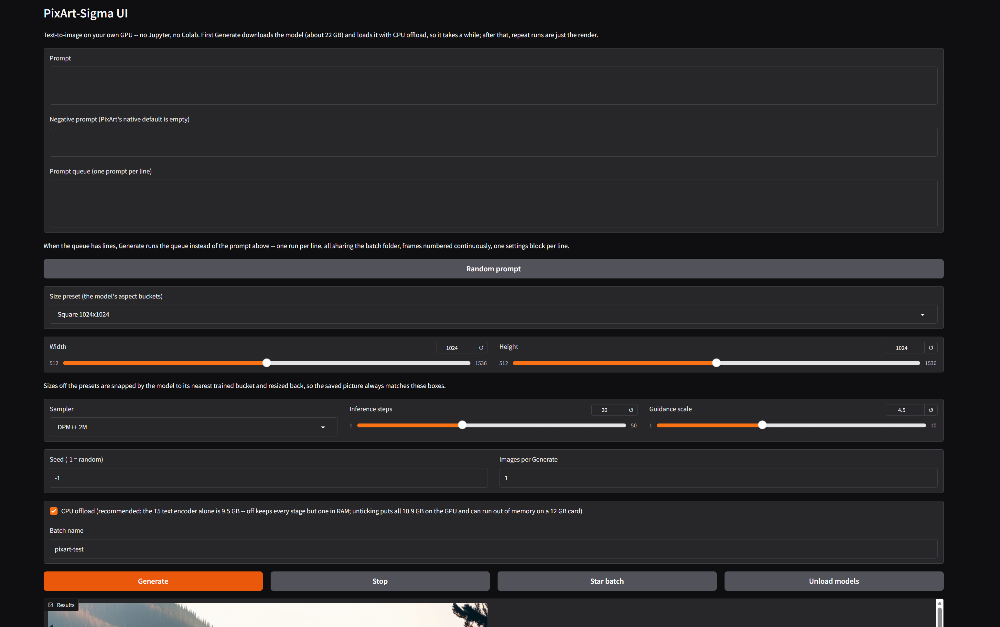
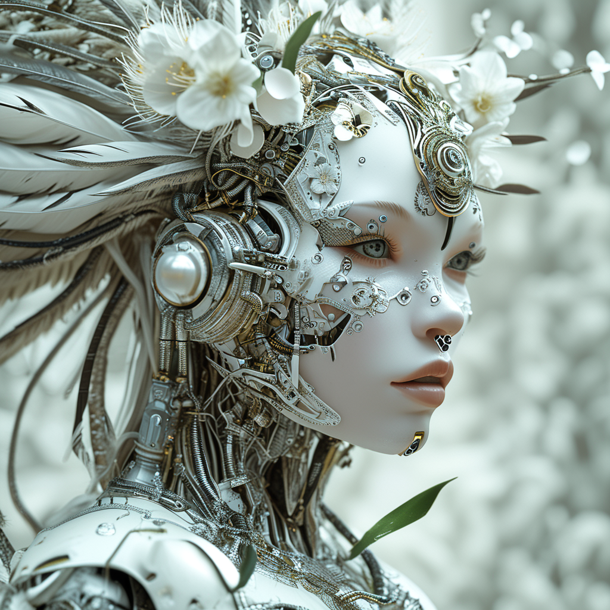
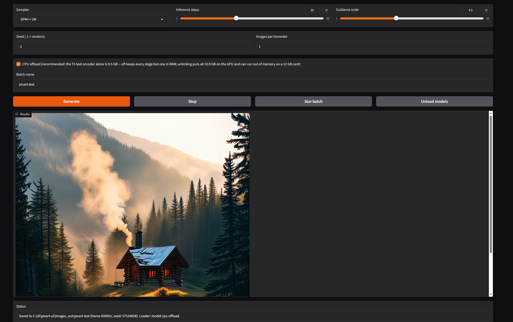

# PixArt-Sigma UI

**PixArt-Sigma text-to-image in a plain standalone app — no Jupyter, no Colab.**

PixArt-Sigma is a diffusion *transformer* (not a U-Net like Stable Diffusion): a T5-XXL text encoder with a 300-token prompt budget — far past CLIP's 77 — feeding a 0.6B transformer that paints at a native 1024px in a family of aspect ratios. This app wraps it in the same plain shape as the other UIs in this family (Kandinsky, Sana, Z-Image, SD 3.5, SD 1.5, SDXL): run it, a page opens in your browser, type a prompt, pictures appear. Simple on the surface, everything underneath, clean looking.

**Status: PC-proven build.** First picture verified on a real PC on Oct 28, 2026 (RTX 4070 12 GB, 16 GB system RAM): frame 000001, a log cabin in a pine forest at dawn — see Example output below — with many more renders since. Single-image generation runs at full speed. Multi-image batches on 16 GB RAM systems have a known issue — see **Known issues** below before running long batches.

## What it does

- **Text to image** — prompt + negative prompt, size presets (the model's own aspect buckets: Square 1024×1024, 1152×896, 896×1152, 1216×832, 832×1216, Wide 1344×768, Tall 768×1344, Cinema 1536×640, Vertical 640×1536) plus width/height sliders. Off-preset sizes are snapped by the model to its nearest trained bucket internally and resized back, so the saved picture always matches the boxes.
- **Steps** (default 20) and **guidance** (default 4.5) — the pipeline's own defaults. **Seed** box (-1 = random; a fixed seed reproduces, and multi-image runs step it +1 per image).
- **Samplers** — DPM++ 2M (the scheduler exactly as the checkpoint ships it: DPM-Solver++, midpoint, order 2), DPM++ 2M Karras, DPM++ SDE, Euler, DDIM. Every sampler is built from the checkpoint's own scheduler config, so the betas and timestep spacing always match the model's training.
- **Negative prompt** — supported, and the default is **empty on purpose**: PixArt's guidance was trained against the empty string. Type one if you want one; it is not pre-filled with the SD family's "low quality, bad quality".
- **LoRA** — one slot with a weight slider, for LoRAs trained on PixArt. Drop the `.safetensors` file in the `loras/` folder, hit **Refresh list**, pick it, and generate; settings.txt records the file and weight for every run. See the LoRA section below.
- **Prompt queue** — one prompt per line; when the queue has lines it runs instead of the prompt box, all lines sharing one batch folder with continuous frame numbering and one settings block per line.
- **Dynamic prompts** — `{a|b|c}` groups re-rolled per image.
- **Random prompt** button — a line from `random_prompts.txt` next to the app, read fresh per click; edit the file to make it yours.
- **History** — the last 10 jobs; picking one restores its prompt *and* its settings.
- **Star batch** (copies the last batch into `images_out/favorites/`, never overwrites), **Stop**, and **Unload models**.
- Batch folders under `images_out/<batch name>/`, reused across runs, frames numbered continuously (`000001.png`, `000002.png`, …), with a `settings.txt` block per run logging **everything** — prompt as typed, the expanded prompt actually used, negative, sampler, size, steps, guidance, every seed, the model, the dtype, and which loader path ran — so any picture can be reproduced.
- Memory is freed between images inside a run, so long queues don't creep upward.
- Multi-image runs encode the prompt **once** and reuse the embeddings for every image in the run, so the 9.5 GB text encoder is not swept on and off the GPU per image — that keeps long batches inside the memory budget on a 16 GB machine.
- No token, no license step: the model (`PixArt-alpha/PixArt-Sigma-XL-2-1024-MS`, OpenRAIL++ license) is public and ungated.

## Memory: why CPU offload is on

Everything loads in float16, following the model card's own usage snippet: the T5-XXL text encoder is 9.5 GB, the transformer 1.2 GB, the VAE 0.2 GB — about **10.9 GB of weights**. On a 12 GB card that plus sampling activations does not fit all at once, so the app runs **model CPU offload by default**: one stage at a time sits on the GPU (the pipeline's own order: text encoder → transformer → VAE) and the rest park in system RAM. On a 16 GB machine the parked weights and the app fit with headroom, and queues run walk-away without creeping memory.

The **CPU offload** checkbox can be unticked to hold everything on the GPU at once — on a 12 GB card that is expected to run out of memory; it is there for bigger cards. settings.txt records which path each run used.

One dtype story throughout: every component loads in float16 and none is ever upcast against the others — the rule this family learned from SDXL's first-run failure.

## LoRAs

PixArt is a transformer, so a PixArt LoRA patches the transformer's attention and feed-forward layers — the text encoder is untouched, which is also why LoRAs change nothing about the prompt encoding or the batch memory design above.

- **Which files:** LoRAs **trained on PixArt / PixArt-Sigma only**, as a single `.safetensors` file in the diffusers/PEFT format (keys like `transformer_blocks.0.attn1.to_q.lora_A.weight`, with or without a leading `transformer.` prefix — both load). SD 1.5, SDXL and SD 3.5 LoRAs do not fit this model, and kohya-format files are refused with a message rather than loaded wrong.
- **Where:** put the file in the `loras/` folder next to `app.py`, then click **Refresh list** in the app and pick it in the LoRA dropdown. `None` means no LoRA.
- **Weight:** the slider runs 0.0–1.5 and defaults to **0.8**, the family convention. 1.0 is the strength the LoRA was trained at; lower softens the effect, higher pushes it (and can push it too far). The file and weight used are written into every run's settings block.
- **One slot:** there is deliberately one slot, not two. Under the pinned Diffusers 0.39.0 loader, a second adapter does not load cleanly on this transformer (verified against the real model classes when this was built), so the app ships the one slot that is proven rather than a second that fails on real files.
- Diffusers 0.39.0 ships no LoRA support for the PixArt pipeline itself; this app loads the adapter through Diffusers' own transformer-level PEFT loader — the same code its supported DiT pipelines delegate to — with the `peft` package pinned in `requirements.txt`. **install.bat installs the peft library the slot needs**, along with the other packages, so a fresh install needs no extra step. If you are updating an existing install by swapping in the new `app.py`, re-run install.bat once so peft gets installed.

## Known issues

- **Multi-image batches on 16 GB RAM systems:** Multi-image batches currently run much slower per image than single images on 16 GB RAM systems (observed ~12 s/step in batch vs ~1.25 s/step single at 1024×1024) and long batches can strain system memory. Single-image generation runs at full speed and is recommended for now. A first fix attempt (Oct 28) did not cure the batch pace; investigation is ongoing.

## Install

1. Extract the zip anywhere (a short path like `C:\AI\pixart-ui` is best).
2. Double-click **install.bat**. Python is bundled in `python_embeded\` — nothing to install first, no venv, no system Python touched. It installs PyTorch with CUDA support (the big download, ~2.5 GB), then the remaining packages.
3. Double-click **run.bat**. The app opens in your browser at a local address.

First Generate downloads the model (**about 22 GB** — the text encoder ships as float32 weights) into the Hugging Face cache on your user profile.

## Folders

- `images_out/` — your batches, one folder per batch name, `settings.txt` beside the frames; `images_out/favorites/` holds starred batches.
- `loras/` — your PixArt LoRA files (`.safetensors`); see the LoRA section.
- `random_prompts.txt` — the Random prompt button's list; edit freely.

## Requirements

- Windows, an NVIDIA GPU with 12 GB VRAM (built and tuned for an RTX 4070, 12 GB, with 16 GB system RAM), a recent driver, and an internet connection for the installs and model downloads.
- About 25 GB of free disk for the package installs and the model download.
- No Python installation needed — it's bundled.

## Deferred in this version

- **No img2img / inpainting** — Diffusers ships no standard PixArt img2img or inpaint pipeline, so there is nothing honest to wire a tab to yet.
- **No ControlNet or embeddings** — no standard Diffusers support for PixArt in this release line. (LoRAs *are* supported — one slot; see the LoRA section.)
- **No prompt weighting or blending, no animation, no upscaling** — possible future extras, in the family pattern.

MIT licensed, like the other UIs in this family.

## Example output

*Alan's showcase pick: frame 000004 — porcelain cyborg profile with white blossoms. 1024x1024, DPM++ 2M, 50 steps, guidance 4.5, seed 421033878*

*First picture from the published build: frame 000001 — a log cabin in a pine forest at dawn. 1024x1024, DPM++ 2M, 20 steps, guidance 4.5, seed 57534858, model CPU offload on.*
